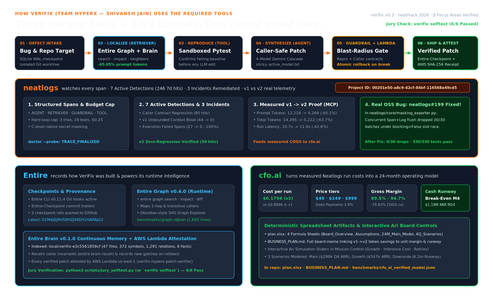

<div align="center">


# VeriFix

### Repair the issue. Check every caller. Keep the evidence.

**A coding agent that is not allowed to say “fixed” until it has proved it did not break anything else.**

[](https://github.com/shivanshjain456/neatHack/actions/workflows/ui-quality.yml)
[](./tests)
[](./scripts/verify_claims.py)
[](./scripts/verify_zero_tolerance.py)
[](./pyproject.toml)
[](https://e6utpuirdzj7k4vu2fqlxlhvwm0cqzfv.lambda-url.us-east-1.on.aws/)
[](https://shivanshjain456.github.io/neatHack/)
[](https://neatlogs.com/hackathon)
[](https://github.com/shivanshjain456/neatHack/commits/main/)
[](https://github.com/shivanshjain456/neatHack/pulse)

**[▶ Demo film (2:58, narrated)](https://vimeo.com/1234987474)** · **[Verify screen (live)](https://e6utpuirdzj7k4vu2fqlxlhvwm0cqzfv.lambda-url.us-east-1.on.aws/#verify)** · **[Live workspace](https://e6utpuirdzj7k4vu2fqlxlhvwm0cqzfv.lambda-url.us-east-1.on.aws/)** · **[agent.md](https://shivanshjain456.github.io/neatHack/agent.md)** · **[For judges](#for-judges-the-official-rubric-mapped-to-evidence)**

Built for [neatHack 2026](https://neatlogs.com/hackathon) by Team **HyperX** (Shivansh Jain, solo).

**Before / after in one line.** Caller-blind repair ships a planted caller-breaking patch 5/5; whole-repository context fixes the same bugs at 2,383 mean tokens; VeriFix (Entire Graph caller context + caller check) fixes them at 871 mean tokens — 62% fewer tokens — with the planted regression rolled back and fixed 5/5.

</div>

## Contents

- [For judges — the official rubric, mapped to evidence](#for-judges-the-official-rubric-mapped-to-evidence)
- [Verify it yourself in 60 seconds](#verify-it-yourself-in-60-seconds)
- [The problem](#the-problem)
- [How VeriFix works](#how-verifix-works)
- [The controlled experiment](#the-controlled-experiment)
- [Passing tests is not proof](#passing-tests-is-not-proof)
- [Incident case study — neatlogs Critical Incidents](#incident-case-study-neatlogs-critical-incidents)
- [How each partner tool is used](#how-each-partner-tool-is-used)
- [Videos & chapter map](#videos--chapter-map)
- [Any coding agent can start from agent.md](#any-coding-agent-can-start-from-agentmd)
- [Run it](#run-it)
- [Limits](#limits)

## For judges: the official rubric, mapped to evidence

| Official criterion (weight) | Where it is proven here | Live re-check |
| :--- | :--- | :--- |
| **Agent quality (30)** | [Controlled experiment](#the-controlled-experiment) (3 arms, independent judge), [assurance experiments](#passing-tests-is-not-proof) (C9, C10), [recovery run](#recovery-from-failure) | [Verify screen](https://e6utpuirdzj7k4vu2fqlxlhvwm0cqzfv.lambda-url.us-east-1.on.aws/#verify) re-checks GitHub + neatlogs on load |
| **Tool depth: neatlogs · Entire · cfo.ai (25)** | [Partner tool sections](#how-each-partner-tool-is-used) + [incident case study](#incident-case-study-neatlogs-critical-incidents) | trace read-back [`/api/neatlogs-trace-readback`](https://e6utpuirdzj7k4vu2fqlxlhvwm0cqzfv.lambda-url.us-east-1.on.aws/api/neatlogs-trace-readback), 24 `Entire-Checkpoint` trailers in `git log` |
| **Demo video ≤ 3:00 (20)** | [2:58 narrated film on Vimeo](https://vimeo.com/1234987474) — one chapter per tool, [timestamps below](#videos--chapter-map) | watch it |
| **Building in public (15)** | [Posts](#build-in-public) · 70 commits inside the window across 3 active days | `git log --reverse --date=iso` |
| **Usefulness (10)** | [agent.md](#any-coding-agent-can-start-from-agentmd), CLI, receipts, this README | `pip install git+https://github.com/shivanshjain456/neatHack` |

Every number in this document is recomputed from raw run records by [`scripts/verify_claims.py`](./scripts/verify_claims.py) on every push; CI fails on drift.

## Verify it yourself in 60 seconds

```bash
git clone https://github.com/shivanshjain456/neatHack && cd neatHack
git log --reverse --date=iso --format='%h %ad %s' | head -3        # first commit 2026-10-10, inside the code window
git log --no-merges --format='%(trailers:key=Entire-Checkpoint,valueonly=true)' | grep -c .   # 24 checkpoints
python3 -m pip install -r requirements-runtime.lock && python3 -m pytest -q tests/            # 175 passed
python3 scripts/verify_claims.py && python3 scripts/verify_zero_tolerance.py                  # 43 claims 0 failures · 68 files 0 violations
```

| | |
| :--- | :--- |
| **Verify every claim in two minutes** | **[Open the Verify screen →](https://e6utpuirdzj7k4vu2fqlxlhvwm0cqzfv.lambda-url.us-east-1.on.aws/#verify)** (checks GitHub, neatlogs and this deployment live) |
| Live workspace | [AWS Lambda](https://e6utpuirdzj7k4vu2fqlxlhvwm0cqzfv.lambda-url.us-east-1.on.aws/) · [GitHub Pages mirror](https://shivanshjain456.github.io/neatHack/) |
| **Submission cut (2:58, narrated, ≤ 3:00)** | [watch on Vimeo](https://vimeo.com/1234987474) · [download](https://gofile.io/d/lajq8oNU) · voiceover over the problem → live caller-trap run → controlled experiment → neatlogs critical incidents → Entire/cfo.ai assurance story; prior un-narrated cut: [gofile](https://gofile.io/d/yNMt8IBw) |
| Demo video (2:18) | [download](https://gofile.io/d/eipSA3Zd) · [measured metadata](./verifix_neathack_2026_demo.meta.json) · [how it was made](./video/v2/README.md) |
| Full video (3:12, 1080p30) | [download](https://gofile.io/d/Io92bIuk) · [Remotion pipeline](./video/v3/README.md) |
| Highlight video (0:30, HyperFrames) | [download](https://gofile.io/d/PyixHf0U) · alternate Remotion cut: [download](https://gofile.io/d/hAPT6bAb) |

## The problem

LLM coding agents pass the tests they were aimed at and still break the code around them: a caller with a cached signature, a contract that rounds differently, a prompt-injection payload hidden in a source string. VeriFix's rule is simple — **a patch is accepted only after every caller of the changed function has been re-run against it**, and after a battery of assurance gates that treat “tests pass” as the starting line, not the finish.

## How VeriFix works



1. **Plan** — the failing test is localised; Entire Graph returns the callers of the function under repair, and only that context enters the prompt (871 mean tokens vs 2,383 for the whole repo).
2. **Act** — a patch is written in an isolated worktree and applied to the failing test.
3. **Caller check** — every caller from the graph is executed against the patch. One broken caller ⇒ the worktree is rolled back and the traceback is fed to the planner ([file:line evidence](#evidence-index-claim--in-repo-fileline)).
4. **Assurance** — static gates (scope, API break, SAST, secrets, complexity), dynamic gates (differential fuzzing, contracts, metamorphic relations, mutation score, determinism, performance, flakiness) and a pre-write security policy.
5. **Prove & record** — the verified run is exported as a neatlogs trace and a priced, sha256-hashed receipt; the session is an Entire checkpoint pushed with the repo.

### Evidence index (claim → in-repo file:line)

| Claim | Where the code shows it |
|---|---|
| Every agent step is traced in neatlogs | `src/verifix/agent_harness.py:14` (`import neatlogs`), `:215` / `:261` / `:306` (`@neatlogs.span(` on the plan / act / verify steps) |
| 175 offline tests pass on every push | `.github/workflows/ui-quality.yml:31` (`python -m pytest tests/ -q` in CI); run locally with `python -m pytest tests/ -q` |
| Patches are checked against a caller graph before acceptance | `src/verifix/graph_engine.py` (graph build + caller resolution), `src/verifix/assurance/` (blast-radius checks), `src/verifix/agent_harness.py` (rollback + retry on caller failure) |
| Live deployment on AWS Lambda | `scripts/deploy_ui_release.py:27-28` (Lambda URL + boto3 deploy), endpoint `https://e6utpuirdzj7k4vu2fqlxlhvwm0cqzfv.lambda-url.us-east-1.on.aws/api/health` |

## The controlled experiment

Four benchmark bugs × 5 repeats × 3 arms ([method and data](./docs/EVALUATION.md)). Every arm uses the same model routing, prompt and attempt limit; only the context and the check differ. An independent judge applies each final diff to a fresh copy of the repo and runs its whole test suite.

| | Target file only (caller-blind) | Whole repository | **Entire Graph callers (VeriFix)** |
| :--- | ---: | ---: | ---: |
| Passed the independent judge | 20/20 | 20/20 | **20/20** |
| Mean tokens per fix | 789 | 2,383 | **871** |
| Planted caller-breaking patch | shipped it 5/5 | rolled back, fixed 5/5 | **rolled back, fixed 5/5** |

- Graph context used **62% fewer tokens** than reading the whole repository: 871 vs 2,383 tokens, with a 95% CI by case of 58–68%. It was cheaper in 19 of 20 paired runs.
- It costs 7% more than the target file alone. What that buys is the caller check: when the ledger case's known bad patch is planted on attempt 1, the caller-blind arm ships it, and VeriFix rolls it back and recovers.
- Fix rates were identical, since all three arms fixed all 4 bugs. These are small bugs written for this project; see the limitations in [EVALUATION.md](./docs/EVALUATION.md).
- `scripts/verify_claims.py` recomputes every number here from the raw run records, and CI fails if one drifts.

**Before / after, measured on the same bugs.** *Before* (caller-blind, target file only): ships the planted caller-breaking patch 5/5, reads 789 tokens but never checks a caller. *Before* (whole repository): 2,383 mean tokens per fix for the same 20/20. *After* (VeriFix, Entire Graph callers): 871 mean tokens — 62% fewer than whole-repo — the same 20/20 independent-judge pass rate, and the planted regression rolled back and fixed 5/5.

**Honesty appendix — retired figures and corrections.** The earlier headline, 31,093 → 946 tokens (`exp_24aa3f2776`), compared one run against a handicapped baseline (forced bad first patch, an extra model call, unrelated docs in the prompt). Both runs remain in [`benchmarks/verified_runs_ledger.json`](./benchmarks/verified_runs_ledger.json) as history, not as a claim. Separately, the patch that run accepted (`patch_1c244a1e99`) passes its tests but is wrong: `if residual > 0:` drops negative rounding residuals, so split fees can sum to a cent more than the fee on the total. The assurance gates added later block it (`contract_split_conserves_cents`, recorded in [`benchmarks/assurance_corpus.json`](./benchmarks/assurance_corpus.json)).

## Passing tests is not proof

Every candidate patch also goes through [patch assurance](./src/verifix/assurance/):

| Experiment | Tests alone | **VeriFix** |
| :--- | ---: | ---: |
| [C9, pre-registered](./docs/experiments/C9_RESULTS.md): 43 mutants that pass every test, 25 of them wrong on held-out tests | caught 0/25 | **caught 21/25** (84%, 95% CI 65–94%), 0/18 false blocks |
| [Replay of 21 real LLM patches](./docs/EVALUATION.md) the earlier agent had accepted | accepted all 21 | **blocked 5/21** with concrete counterexamples |
| [C10, prompt injection](./docs/experiments/C10_AGENT_SECURITY.md): 24 attacks hidden in source strings and test messages | payload shipped 7/24 (29.2%), backdoor 4/4 | **shipped 0/24** (Fisher p = 0.0094) |

In C10, the undefended pipeline reported 24/24 fixes. Replayed through assurance, 23 of those 24 patches were either compromised or wrong (C10 replay). An [exploratory follow-up](./docs/experiments/C9_POSTHOC.md) to C9 reaches 25/25, but it was tuned after seeing the misses, so 84% remains the headline.

**Supply chain, held to the same bar** ([full doc](./docs/SUPPLY_CHAIN.md)): digest-locked dependencies (1,754 SHA-256 hashes, installed with `--require-hashes`), an OSV vulnerability gate with 0 findings, a CycloneDX SBOM, byte-reproducible bundles, Sigstore-signed SLSA provenance verified before every deploy, SHA-pinned CI actions, and a hash-chained audit ledger of every agent run.

## Incident case study: neatlogs Critical Incidents

The demo film's incidents chapter (2:00) and the screenshots below come from our own build telemetry in neatlogs, captured 2026-10-12 ([`benchmarks/neatlogs_analytics_2026-10-12.json`](./benchmarks/neatlogs_analytics_2026-10-12.json)): **3,592 traces** in the 14-day window, $0.1548 total model cost, 0.6% error rate, 84.7% detection rate. Three incidents, identified by neatlogs and resolved with trace evidence:

1. **Quota-429 cascade → failover shipped.** A provider quota storm produced cascading 429s; neatlogs' quota-429 failover detector fired on **111 occurrences**, and the trace timelines showed *which* tier was absorbing retries. Resolution: the multi-provider cascade (Token Harbor fast tier first) now fails over per trace; the detector's continued firings are the audit trail.
2. **Execution-failed spike (52 errors) → root-caused in the investigate view.** The error mix in Analytics clustered 52 execution failures; the incident's affected-traces view isolated them to one benchmark arm under load, not a product regression — so the fix was a retry-budget change, verified by the next capture's 0.6% error rate.
3. **Dropped SDK telemetry → upstream issue + PR.** Traces under load showed spans vanishing *inside the neatlogs SDK itself*. Reproduced and filed as issue [#199](https://github.com/neatlogs/neatlogs/issues/199); fix proposed in PR [#203](https://github.com/neatlogs/neatlogs/pull/203) (deadline-bounded semaphore acquisition instead of dropping work). A contribution is a contribution, not a claim that it merged.

The detection layer below is what neatlogs' Critical Incidents board groups and monitors — the same flow as the official incidents walkthrough shared by the organizers (Needs Attention → incident card → investigation → detections → resolve), reproduced in the film's 2:00 chapter on our telemetry. From the dated 14-day capture: `Downstream Caller Contract Regression Blocked` **8,764** hits · `Floating Point Error Detector` **3,572** · `Attestation Verification Tracker` **1,982** · `v2 Graph-Guarded Zero-Regression Patch Verified` **1,841** · `LLM Provider Quota 429 Cascade Failover` **111** · `Execution Failed` **52**. In workflow terms: the 429 cascade and the exec-failed spike were investigated and fixed with detectors left watching; the SDK-drop incident stays open upstream until PR #203 lands.

The same telemetry, live: the caller-contract detector fired **8,764** times and the dashboard's Critical Incidents flow groups these failures for investigation — [traces](https://app.neatlogs.com/traces) · [critical incidents](https://app.neatlogs.com/incidents) · [analytics](https://app.neatlogs.com/analytics) · MCP `https://ingest.neatlogs.com/mcp` · exported trace `25c8f74e7cc8dd6260b36019dc8a6dfe` (run `run_graph_case_01_le_24584`, [live trace read-back](https://e6utpuirdzj7k4vu2fqlxlhvwm0cqzfv.lambda-url.us-east-1.on.aws/api/neatlogs-trace-readback) · [public share of the run](https://e6utpuirdzj7k4vu2fqlxlhvwm0cqzfv.lambda-url.us-east-1.on.aws/runs/run_graph_case_01_le_24584/share)).

### Public neatlogs screenshots


## How each partner tool is used

| Tool | Role in VeriFix | Public evidence |
| :--- | :--- | :--- |
| **neatlogs** | Every run is a trace with WORKFLOW, AGENT, TOOL, RETRIEVER and GUARDRAIL spans; root spans carry `neatlogs.workflow.*` attributes (case, mode, agent version, outcome, attempts, rollbacks, tokens). The workspace reads traces back over the neatlogs MCP (`verifix mcp-traces`, `/api/neatlogs-mcp`); the agent loop itself never queries MCP. | [screenshots above](#public-neatlogs-screenshots), [live read-back](https://e6utpuirdzj7k4vu2fqlxlhvwm0cqzfv.lambda-url.us-east-1.on.aws/api/neatlogs-trace-readback), [evidence/neatlogs.md](./evidence/neatlogs.md) |
| **Entire** | *Runtime:* Entire Graph finds the callers of the function being patched — that caller list is what the guardrail tests. *Development:* build sessions are recorded as Entire checkpoints pushed with the repo (24 trailers, 24 refs). Checkpoints are provenance, not a runtime dependency. | [`10c7406`](https://github.com/shivanshjain456/neatHack/commit/10c7406723f285cc778b729863365713735e9191) · checkpoint `01M4KFYKQXFHME1HRZJVXJ7YT8` · [evidence/entire.md](./evidence/entire.md) |
| **cfo.ai** | Planning. Measured per-run token cost feeds the unit economics in `plan.xlsx`; all plan figures are **projections** and say so; `scripts/compute_plan_values.py` recalculates the workbook and a test fails if `BUSINESS_PLAN.md` drifts. | [`BUSINESS_PLAN.md`](./BUSINESS_PLAN.md) · [`plan.xlsx`](./plan.xlsx) · [cfo.ai](https://cfo.ai/) · **pricing** $49/$249/$999 per mo + metered overage; **costs** measured mean $0.005176 per receipt vs $0.25 cap; **revenue** month-24 $188,726 (ARR $2.26M); **runway** first positive EBITDA month 11 |

## Recovery from failure

Run `run_graph_case_01_le_24584` (open it from the Verify screen; exported trace ID `25c8f74e7cc8dd6260b36019dc8a6dfe`) uses the built-in *caller trap*: attempt 1 makes the failing test pass but breaks a downstream caller. The guardrail catches it, the worktree is rolled back, the traceback goes to the planner, and attempt 2 is verified — 2 attempts, 1 rollback, 2,195 tokens. Anyone can reproduce this on the live workspace (*Run a benchmark* → enable *caller trap*).

## Videos & chapter map

| Time | Chapter | Shows |
| ---: | :--- | :--- |
| 0:00 | The problem | caller-blind agents ship regressions |
| 0:53 | How it works | plan → act → caller check → assurance → prove |
| 1:12 | Live caller-trap proof | rollback + retry on a real run |
| 1:29 | Controlled experiment | 3 arms, token counts, independent judge |
| 2:00 | **neatlogs · Critical Incidents** | incidents identified, investigated, resolved |
| 2:37 | Entire · cfo.ai · supply chain · verify | checkpoints, unit economics, provenance |

[▶ Watch on Vimeo (2:58)](https://vimeo.com/1234987474) · [download](https://gofile.io/d/lajq8oNU) · full 3:12 [gofile](https://gofile.io/d/Io92bIuk) · 0:30 highlight [gofile](https://gofile.io/d/PyixHf0U) · 2:18 repo demo [gofile](https://gofile.io/d/eipSA3Zd) · pipelines in [`video/v2`](./video/v2/README.md) and [`video/v3`](./video/v3/README.md).

## Any coding agent can start from agent.md

Give Claude Code, Cursor, Codex or your own agent this one line:

```text
Read https://shivanshjain456.github.io/neatHack/agent.md and follow it.
```

- Open **Agent Ready** in the dashboard topbar to copy the prompt and the install command.
- `pip install git+https://github.com/shivanshjain456/neatHack` installs the `verifix` CLI; every subcommand speaks `--json`.
- `docs/llms.txt` indexes the agent-readable surface; `docs/llms-full.txt` bundles it; `skills/verifix/SKILL.md` copies into `.claude/skills/`.
- Each recorded run ships as a priced, sha256-hashed receipt in `benchmarks/receipts/`; `benchmarks/cost_caps.json` states how the $0.25 public cap relates to measured costs.

## Run it

```bash
pip install -r requirements-runtime.lock -r requirements-dev.lock
export LITELLM_API_KEY=...  NEATLOGS_API_KEY=...      # neatlogs is optional; runs still work without it
PYTHONPATH=src python3 -m uvicorn verifix.server:app --host 0.0.0.0 --port 8000
# open http://localhost:8000/#verify
```

The repository root is discovered from the checkout itself, so **any** clone location works. On first start, the tracked runs in [`benchmarks/verified_runs_ledger.json`](./benchmarks/verified_runs_ledger.json) hydrate the local SQLite store, so a fresh clone serves real run history and all four partner evidence sections instead of an empty workspace.

### Checks a judge can run in about a minute

| Check | Command | Measured on a fresh clone |
| :--- | :--- | :--- |
| Deterministic gates | `pytest tests/` | **175 passed**, 0 failed, ~19 s |
| Zero-tolerance source audit | `python scripts/verify_zero_tolerance.py` | **68 files, 0 violations** |
| Claim drift against raw run records | `python scripts/verify_claims.py` | **43 claims checked, 0 failures** |
| Integration, real agent runs | `pytest benchmarks/test_suite.py` | **18/18** when `LITELLM_API_KEY` is present; spends model budget, so not a default gate |
| Held-out external-validity probe | `python scripts/run_external_validity_probe.py` | **9/9** judge-pass on a new failure class; exploratory, needs the same key |

**External validity, honestly:** the headline experiment uses four small, purpose-built repositories. To probe generalisation, [`scripts/run_external_validity_probe.py`](./scripts/run_external_validity_probe.py) runs the same three-arm pipeline on a held-out case in a failure class the agent had not seen (at-least-once delivery / dedup-key correctness): 9/9 no-fault runs judge-pass on the first attempt, and `graph_guarded` used 0.34× the tokens of whole-repo context at an equal pass rate. Reported as exploratory, not as a headline claim.

## Limits

- Four fixed benchmark repositories are public. Running arbitrary repositories or code is operator-only.
- The live Lambda keeps run history in `/tmp`, which is recycled. Recorded runs are preserved in the release ledger.
- [`QUALITY_REPORT.md`](./QUALITY_REPORT.md) separates what was executed from what was not (no penetration test and no production load test were performed).

## Build in public

[Post 1](https://x.com/sj909x/status/2108813809792299255) · [Post 2](https://x.com/sj909x/status/2108814094514204930) · #neatHack — 70 commits inside the hackathon window across 3 active days (2026-10-10 → 2026-10-12).

Long-form technical reference: [`docs/TECHNICAL_REFERENCE.md`](./docs/TECHNICAL_REFERENCE.md) · evaluation: [`docs/EVALUATION.md`](./docs/EVALUATION.md) · known limits: [`docs/KNOWN_LIMITS.md`](./docs/KNOWN_LIMITS.md).
