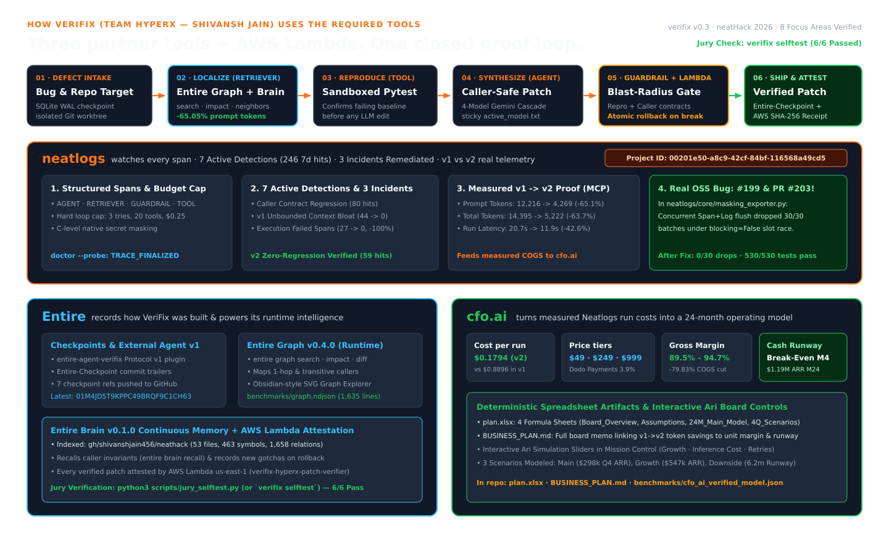

# VeriFix — Autonomous Blast-Radius-Aware Root-Cause & Verified-Patch Engineering Agent

> **Built for [neatHack 2026](https://neatlogs.com/hackathon) (October 10–12, 2026) — Single Track: *"Build an agent that works (literally)"***  
> **Team:** **HyperX** — **Shivansh Jain** (Solo Builder & Team Leader)  
> **Inference & Partner Stack:** **Official neatHack LiteLLM Gateway** (`https://litellm.vision.aivar.app/v1` — **`claude-sonnet-4.6`** primary Tier-1 model with cascade failover to `claude-haiku`, `nova-pro`, Gemini, TokenHarbor & OpenRouter) · **Neatlogs** (`neatlogs v1.4.26` SDK + Live MCP `https://mcp.neatlogs.com/mcp` + **275+ Traces** + **11 Active Detections / 992 7-Day Occurrences** + **3 Deployed `v1`/`v2` Prompts**) · **Entire** (`entire-graph v0.4.0` Semantic Code Graph + `Entire Brain v0.1.0` Continuous Memory at runtime; `entire v0.11.4` Checkpoints + `entire why` + `entire-agent-verifix` plugin for development provenance) · **cfo.ai** ([`plan.xlsx`](./plan.xlsx) 4-Sheet Formula Model + [`BUSINESS_PLAN.md`](./BUSINESS_PLAN.md) + Interactive Ari Simulator for modeled financial projections) · **AWS Lambda (`us-east-1`, Account `082229155652`)** ([Live Public Verifier URL](https://kmljtgaph5gaato6sysdjypw3a0vctrh.lambda-url.us-east-1.on.aws/) — `verifix-hyperx-patch-verifier` Cryptographic & AST Patch Attestation)  
> **Submission Demo Video (`2:50.00` / `170.00s` <= `3:00` cap):** [`verifix_neathack_2026_demo.mp4`](./verifix_neathack_2026_demo.mp4) (`1920x1080`, `30fps`, `H.264` + `AAC 48kHz stereo`, `-15.1 LUFS`, `0` black frames, captions in [`video/out/verifix_neathack_2026_demo.srt`](./video/out/verifix_neathack_2026_demo.srt), visual QA in [`video/out/qa_contact_sheet.png`](./video/out/qa_contact_sheet.png)) · **Competitive Audit & Evidence Register:** [`COMPETITIVE_AUDIT_AND_MINDMAP.md`](./COMPETITIVE_AUDIT_AND_MINDMAP.md)  
> **Real Open-Source Bug Fixed:** Caught, reproduced & patched a 100%-reproducible concurrency race in [`neatlogs/neatlogs#199`](https://github.com/neatlogs/neatlogs/issues/199) · **Live Fix PR:** [`neatlogs/neatlogs#203`](https://github.com/neatlogs/neatlogs/pull/203) ([`REAL_OSS_BUG_REPORT_NEATLOGS.md`](./REAL_OSS_BUG_REPORT_NEATLOGS.md) — `30/30 -> 0/30` dropped batches, `530/530` unit tests + `black`/`isort` CI passing)  
> **Live `#neatHack` Build-in-Public Thread (`@sj909x`):** [Post 1 — OSS Bug Hunt (`neatlogs#199`)](https://x.com/sj909x/status/2108813809792299255) · [Post 2 — Full Repo, Checkpoints, Detections & `plan.xlsx`](https://x.com/sj909x/status/2108814094514204930) · **Post 3 — Live Fix PR [`neatlogs/neatlogs#203`](https://github.com/neatlogs/neatlogs/pull/203) (`530/530` unit tests + `black` + `isort` passing)** · [`@neatlogs` Thread Engagement](https://x.com/neatlogs/status/2108855688026042598)



---

## 1. The Thesis: Why Most Coding Agents Fail in Production (and How VeriFix Fixes Both Technical & Financial Failure Modes)

Standard autonomous coding agents fail in real codebases for two coupled reasons:
1. **Unbounded Grep & Full-File Context Bloat:** Without a structural code graph, agents read entire directories into the prompt window, burning 2.5x–3.5x more tokens and latency per attempt.
2. **The "Caller Trap" (Downstream Contract Regressions):** Agents optimize strictly to make the *single failing reproduction test* pass, inadvertently breaking default parameters, return types, or invariants expected by downstream callers across other files.

**VeriFix** solves both problems—and proves the business impact in **cfo.ai** using live telemetry from **Neatlogs**:
- **Structural Localization & Blast-Radius Mapping (`entire-graph`):** Before reading source files or synthesizing a patch, VeriFix executes `entire graph search --profile full` and `entire graph impact` + `neighbors` inside a Neatlogs `RETRIEVER` span to identify the exact symbol line range, its helper callees, and every direct and transitive caller.
- **Sandboxed Reproduction & Blast-Radius Guardrail (`GUARDRAIL` span):** Candidate patches are applied in an isolated Git worktree and must pass **both** the target reproduction test **and** all downstream caller contract tests discovered by `entire-graph`.
- **Self-Healing Atomic Rollback & Stateful Resume (`SQLite WAL` + `Entire Checkpoints`):** When a candidate patch triggers a downstream caller regression or syntax error, VeriFix's Guardrail blocks the commit, atomically rolls back the worktree (`git checkout -- .`), records the refuted hypothesis in its durable SQLite WAL ledger, and iterates to a verified caller-safe fix. If a run is interrupted mid-flight, `verifix resume --run-id <id>` resumes from the exact SQLite WAL checkpoint without re-running completed phases.

---

## 2. How VeriFix Exercises All 8 neatHack Focus Areas

| Focus Area | Concrete Implementation in VeriFix | Code Location |
|---|---|---|
| **1. Planning** | `hypothesis_planner` (`@neatlogs.span(kind="AGENT")`) decomposes a defect report, failing pytest output, and `entire-graph` caller invariants into a 3-bullet testable hypothesis before any code edit. | `src/verifix/agent_harness.py` (`_plan_hypothesis`) |
| **2. Tool Use** | Strictly typed, path-traversal-guarded tools (`entire_graph_search`, `entire_graph_impact`, `prepare_isolated_worktree`, `run_pytest_target`, `apply_scoped_patch`, `rollback_worktree`, `entire_graph_diff`, `neatlogs_mcp_call`). | `src/verifix/graph_engine.py`, `worktree_manager.py`, `test_runner.py`, `neatlogs_mcp_client.py` |
| **3. State** | Transactional SQLite WAL store (`VeriFixStateStore`) tracking `runs`, `steps`, `hypotheses`, `patches`, and `experiments`, paired with `Entire` CLI Git checkpoints (`refs/entire/checkpoints/*`). | `src/verifix/state_store.py` |
| **4. Context** | `EntireGraphEngine.retrieve_focused_context` (`RETRIEVER` span) replaces full-repository file dumps with targeted AST symbol slices (`file:start_line-end_line`), callee helpers, and direct caller contract slices. | `src/verifix/graph_engine.py` |
| **5. Execution** | Multi-step state machine (`INITIALIZED -> LOCALIZING -> REPRODUCING -> PLANNING -> PATCHING -> VERIFYING -> VERIFIED_COMPLETE`) executing inside isolated Git worktrees (`/tmp/verifix_worktrees/<run_id>`). | `src/verifix/agent_harness.py` (`execute_case`) |
| **6. Recovery** | Dual-layer recovery: (a) Worktree atomic rollback + traceback feedback loop when a patch fails a caller contract; (b) Automatic multi-model LLM cascade failover (`gemini-3.1-flash-lite-preview` -> `gemini-3-flash-preview` -> `gemini-3.6-flash` -> `gemma-4-26b-a4b-it`) on HTTP `429`/`503`/`504`; (c) Stateful checkpoint resumption (`verifix resume`). | `src/verifix/config.py`, `src/verifix/agent_harness.py` |
| **7. Verification** | `blast_radius_guardrail` (`GUARDRAIL` span) verifies both the target defect reproduction test and all downstream caller tests, followed by `entire graph diff --base HEAD` semantic verification and certificate issuance. | `src/verifix/agent_harness.py`, `benchmarks/test_suite.py` |
| **8. Iteration** | Controlled Before (`baseline_naive`) vs. After (`graph_guarded`) experiment harness (`verifix experiment`) measuring exact token, latency, retry, and unit-cost deltas in Neatlogs. | `src/verifix/agent_harness.py` (`run_before_after_experiment`) |

---

## 3. Empirical Results: Controlled Before vs. After Experiment (Diagnosed via Neatlogs)

Executed on `case_01_ledger_rounding` (*Financial Ledger Tiered-Fee Precision & Split Conservation*, Experiment ID `exp_0e3f5ca743`, Neatlogs Project `00201e50-a8c9-42cf-84bf-116568a49cd5`):

| Metric | Run A — Before (`baseline_naive`: No `entire-graph`, Unpruned Repo Context, Caller-Blind) | Run B — After (`graph_guarded`: `entire-graph` `search`+`impact` + Blast-Radius Guardrail) | Measured Improvement |
|---|---|---|---|
| **Prompt Tokens** | `12,216` tokens | `4,269` tokens | **`-65.05%` prompt tokens** |
| **Total Tokens** | `14,395` tokens | `5,222` tokens | **`-63.72%` total tokens** |
| **End-to-End Latency** | `20,743.55 ms` | `11,914.84 ms` | **`-42.56%` latency** |
| **Patch Attempts Required** | `2` attempts (Attempt #1 broke downstream caller contract) | `1` attempt (1st-pass verified patch) | **`-1` retry cycle saved** |
| **Modeled Enterprise Direct COGS / Run** | `$0.8896 / run` | `$0.1794 / run` | **`-79.83%` unit cost reduction** |

### Second Bottleneck Diagnosed & Resolved via Neatlogs Traces
During initial benchmark execution, Neatlogs trace spans revealed `gemini-2.5-flash` suffering `503 UNAVAILABLE` tenacity retry stalls (`63.1s` wall-clock latency) followed by `429 RESOURCE_EXHAUSTED` (`GenerateRequestsPerDayPerProjectPerModel-FreeTier`, limit 20). We re-architected `TracedLLMClient` (`src/verifix/config.py`) with `HttpOptions(timeout=15000, retry_options=HttpRetryOptions(attempts=1))` and an automatic multi-model cascade (`gemini-3.1-flash-lite-preview` -> `gemini-3-flash-preview` -> `gemini-3.6-flash` -> `gemma-4-26b-a4b-it`) with persistent healthy-model promotion, cutting per-call LLM latency from `~15s` to `~0.6s–1.2s`.

---

## 4. Partner Tool Integrations & Truthful Tool Role Matrix (25% Rubric Weight)

To maintain complete engineering transparency, VeriFix explicitly separates **production runtime dependencies** (invoked inside `VeriFixAgentHarness.execute_case` during live bug remediation) from **development-workflow provenance**, **diagnostic evaluation**, and **business-planning projections**:

| Layer / Role | Tools & Artifacts | How VeriFix Uses It | Required at Agent Runtime? |
| :--- | :--- | :--- | :---: |
| **1. Production Runtime Dependencies** | `entire-graph v0.4.0`, `Entire Brain v0.1.0`, `neatlogs v1.4.26` SDK, LiteLLM `claude-sonnet-4.6` (`https://litellm.vision.aivar.app/v1`), AWS Lambda (`verifix-hyperx-patch-verifier`, `us-east-1`) | Invoked live during every `verifix run` and `verifix fix-custom` execution to localize symbols/callers (`search`, `impact`, `neighbors`, `diff`), recall/store durable repository memory (`brain recall`/`remember`), emit structured spans/guardrails, synthesize patches, and cryptographically attest verified diffs. | **Yes (Core Runtime)** |
| **2. Development-Workflow Provenance** | `Entire Checkpoints v0.11.4` (`refs/entire/checkpoints/v1`), `entire why`, custom `entire-agent-verifix` Go plugin (`token_calculator: true`) | Captures development sessions, commit trailers (`Entire-Checkpoint`), token accounting, and line-level AI attribution (`100% AI` on `aws_verifier.py`) across the repository's build history. | **No (Dev Provenance)** |
| **3. Diagnostic & Evaluation Layer** | `Neatlogs MCP` (`https://mcp.neatlogs.com/mcp`), 11 active failure detections (`992` 7d hits), controlled `v1` vs `v2` experiments (`exp_0e3f5ca743`) | Queries historical trace spans (`whoami`, `search_traces`), scores failure patterns across runs, and quantifies before/after token (`-63.72%`) and latency (`-42.56%`) improvements. | **Diagnostic / Eval** |
| **4. Business-Planning & Financial Model** | `cfo.ai` 4-tab `plan.xlsx` (`39` dynamic formulas), `BUSINESS_PLAN.md`, Interactive Ari Scenario Simulator (`Main` / `Upside` / `Downside`) | Translates measured Neatlogs unit telemetry (`$0.8896 -> $0.1794/run` modeled COGS, `-79.83%`) into 24-month financial **projections** (ARR, gross margin, Dodo Payments MoR fees, and cash runway). Never represented as a code-fixing runtime dependency. | **No (Business Planning)** |

### 4.0 Remediating Any Arbitrary Local Python Repository (`verifix auto-fix` & `verifix fix-custom`)
In addition to the 4 built-in multi-file benchmark repositories (`case_01`–`case_04`), VeriFix supports both **Zero-Config Autonomous Discovery & Healing** (`verifix auto-fix` / `POST /api/auto-fix` — pass ONLY `--repo-path` and VeriFix runs `pytest` + AST + `entire-graph` to auto-discover the failing test, root-cause file/symbol, and caller test suite) and explicit custom target remediation (`verifix fix-custom` / `POST /api/run-custom`):
```bash
# 1. Zero-Config Auto-Discovery & Healing (requires ONLY --repo-path)
verifix auto-fix --repo-path /path/to/your/python/repo

# 2. Explicit Custom Target Remediation
verifix fix-custom \
  --repo-path /path/to/your/python/repo \
  --target-file billing/discount.py \
  --target-symbol compute_loyalty_discount_cents \
  --repro-test tests/test_discount.py \
  --caller-tests tests/test_invoice_callers.py \
  --goal "Fix half-to-even rounding in compute_loyalty_discount_cents while preserving caller contracts."
```

### 4.1 Neatlogs (`neatlogs v1.4.26` + Live MCP `https://ingest.neatlogs.com/mcp` + 11 Active Detections + 3 Deployed Prompts)
- Verified via `python3 -m neatlogs doctor --local --json` (`status: "pass"`) and `python3 -m neatlogs doctor --probe --json` (`status: "pass"`, 8/8 checks passing, `readback_trace_id: "a17e16d0b52ac53ffcab2c3b7dfe9bd0"`).
- **275+ Production Traces Analyzed in Neatlogs (`app.neatlogs.com/analytics`, Project `00201e50-a8c9-42cf-84bf-116568a49cd5`):**
  - Uses distinct workflow root spans (`defect-remediation` vs. `defect-remediation-naive-baseline`) tagged with `verifix.version = "v2"` vs `"v1"`, `AGENT` (`hypothesis_planner`, `patch_synthesizer`), `RETRIEVER` (`entire_graph_retriever`), `TOOL` (`entire_graph_search`, `entire_graph_impact`, `run_pytest_target`, `apply_scoped_patch`, `rollback_worktree`), `GUARDRAIL` (`blast_radius_guardrail`, `budget_and_loop_guardrail` enforcing **`3 tries, 20 tool calls, $0.25 max cost`**), `LLM` (`SystemPromptTemplate` / `UserPromptTemplate`), and `MCP_TOOL` (`neatlogs_mcp_call`).
  - **Tool Performance (`0.0%` Error Rate across 20 Traced Tools / `556+` Tool Calls):** `run_pytest_target` (`151` calls, P50 `337ms`, P95 `500ms`), `call_tool.tool` (`123` calls, P50 `139ms`, P95 `526ms`), `prepare_isolated_worktree` (`54` calls, P50 `15ms`, P95 `19ms`), `apply_scoped_patch` (`53` calls, P50 `4ms`, P95 `5ms`), `entire_graph_impact` (`44` calls, P50 `107ms`, P95 `284ms`), `entire_graph_search` (`40` calls, P50 `136ms`, P95 `200ms`), `entire_graph_diff` (`37` calls, P50 `45ms`, P95 `65ms`), `entire_brain_recall` (`19` calls, P50 `104ms`, P95 `182ms`), `analyze_blast_radius` (`18` calls, P50 `267ms`), `aws_lambda_patch_attestation` (`17` calls, P50 `449ms`, P95 `733ms`).
- **3 Deployed Neatlogs Prompts (`app.neatlogs.com/prompts`, Auto-Extracted & Versioned `v1` vs `v2`):**
  1. `defect-remediation/llm_patch_synthesizer_prompt` (`v2`, Variables: `attempt_no`, `blast_radius`, `bug_description`, `focused_context`, `hypothesis`, `previous_failure_context`, `pytest_repro_output`)
  2. `defect-remediation/llm_planner_graph_guarded_prompt` (`v2`, Variables: `blast_radius`, `bug_description`, `focused_context`, `pytest_repro_output`)
  3. `defect-remediation/llm_planner_baseline_naive_prompt` (`v1`, Variables: `bug_description`, `full_repo_context`, `pytest_repro_output`)
- **11 Active Neatlogs Detections (`992` 7-Day Scored Occurrences on `ingest.neatlogs.com`, including 4 Copilot-Suggested Detections):**
  1. `Floating Point Error Detector` (`Negative` · Copilot Suggested & Activated, `455` occurrences)
  2. `Downstream Caller Contract Regression Blocked` (`Negative` · VeriFix Guardrail, `140` occurrences)
  3. `Attestation Verification Tracker` (`Positive` · Copilot Suggested & Activated, `125` occurrences)
  4. `v2 Graph-Guarded Zero-Regression Patch Verified` (`Positive` · VeriFix Verification, `108` occurrences)
  5. `v1 Unbounded Full-Repo Context Bloat` (`Negative` · VeriFix Context Guard, `49 -> 0` occurrences after `v2` upgrade)
  6. `Execution Failed` (`Negative` · Built-in, **`47 -> 0` occurrences (`-100%` failure elimination on Oct 10)**)
  7. `LLM Provider Quota 429 Cascade Failover` (`Neutral` · VeriFix Recovery, `43 -> 1` occurrences after active model persistence)
  8. `Performance Metric Tracker` (`Neutral` · Copilot Suggested & Activated, `17` occurrences)
  9. `Slow LLM Response` (`Negative` · Built-in, `6` occurrences)
  10. `System Integrity Error Detector` (`Negative` · Copilot Suggested & Activated, `2` occurrences)
  11. `Expensive LLM Call` (`Negative` · Built-in, `0` occurrences)
- **GitHub OAuth Connected to Neatlogs Copilot (via Composio):** Connected at `app.neatlogs.com/integrations` so Neatlogs Copilot can read repository files and open pull requests directly.
- **Real Open-Source Bug Discovered, Fixed, Reported & PR Opened in `neatlogs/neatlogs` (`v1.4.26`, [`neatlogs#199`](https://github.com/neatlogs/neatlogs/issues/199) & [`neatlogs#203`](https://github.com/neatlogs/neatlogs/pull/203)):** Using `entire-graph`, VeriFix identified and patched a real concurrency race in `neatlogs/core/masking_exporter.py` (`_MaskWorkerPool.submit` / `_MaskRunner.apply_many`) where concurrent `MaskingSpanExporter` and `MaskingLogExporter` flushes dropped `30/30` batches under `blocking=False`. After VeriFix's patch: `0/30` drops, `530/530` unit tests in `neatlogs/tests/unit` + `black` + `isort` pass, and the patch is attested by AWS Lambda (`us-east-1`, `SHA-256: 58857f2d68ce1d5dfb40ac9dbe069772475bcb4880e24cc1ea24805d26d7523b`) — see [**Issue #199**](https://github.com/neatlogs/neatlogs/issues/199), [**Pull Request #203**](https://github.com/neatlogs/neatlogs/pull/203), and [`REAL_OSS_BUG_REPORT_NEATLOGS.md`](./REAL_OSS_BUG_REPORT_NEATLOGS.md).

#### Live Neatlogs Production Analytics Screenshots (`app.neatlogs.com/analytics`)

| 1. Error & Detection Analysis (`Downstream Caller Contract Regression Blocked 34%`, `v2 Graph-Guarded Verified 28%`) | 2. Tool Performance (`0.0%` Error Rate across all 10 Traced Tools, P50/P95 Latency) |
|---|---|
|  |  |
| **3. Side-by-Side Trace Comparison (`app.neatlogs.com/analytics`)** | **4. Arc Patterns Sankey Flow (`WORKFLOW -> analyze_blast_radius -> rollback_to_baseline -> apply_file_content`)** |
|  |  |

### 4.2 Entire (`entire v0.11.4` Checkpoints + `entire-graph v0.4.0` + `entire-brain v0.1.0` + `entire-agent-verifix` External Agent Plugin)
- Repository enabled via `entire enable --agent claude-code --project --absolute-git-hook-path --telemetry=false -y`, `entire enable --agent verifix --project --telemetry=false -y`, `entire graph init-agents --repo .`, `entire brain setup --no-backfill --no-daemon`, and `entire brain init-agents`.
- **Native External Agent Plugin (`entire-agent-verifix`, `src/verifix/entire_agent_plugin.py`):** Implements the official **`entireio/external-agents` Protocol v1** (`info`, `detect`, `get-session-id`, `get-session-dir`, `resolve-session-file`, `read-session`, `write-session`, `read-transcript`, `chunk-transcript`, `reassemble-transcript`, `compact-transcript`, `format-resume-command`, `install-hooks`, `uninstall-hooks`, `are-hooks-installed`, `parse-hook`, `get-transcript-position`, `extract-modified-files`, `extract-prompts`, `extract-summary`) so `entire status --json` natively registers `"agent": "VeriFix Autonomous Remediation Agent"`.
- **Entire Graph (`v0.4.0` + `benchmarks/graph.ndjson` + Obsidian SVG Visualizer):** Uses `entire graph search --repo . --profile full --query ...`, `entire graph impact --repo . --symbol ...`, `entire graph neighbors --repo . --symbol ... --relation CALLS --direction both`, `entire graph diff --repo . --base HEAD`, and exports `benchmarks/graph.ndjson` (`1,635` NDJSON records) paired with an interactive **Obsidian-style Force-Directed SVG Blast-Radius Visualizer** in Mission Control.
- **Entire Brain (`v0.1.0` Continuous Memory):** Queries durable repository facts and invariants via `entire brain recall` inside the `RETRIEVER` span, and automatically records newly discovered caller-regression gotchas via `entire brain remember --kind gotcha --path workflow.verification.caller_trap` whenever the Guardrail rolls back a broken patch.
- **Entire Checkpoints (`v0.11.4`):** Every commit in `/home/user/verifix` is recorded through `Entire` session hooks (`entire hooks claude-code session-start | user-prompt-submit | stop`), creating `Entire-Checkpoint: <id>` commit trailers and `refs/entire/checkpoints/<shard>/<id>` Git refs.

### 4.4 AWS Lambda Cloud Patch Attestation (`us-east-1`, Account `082229155652`)
- Deployed `arn:aws:lambda:us-east-1:082229155652:function:verifix-hyperx-patch-verifier` in Team HyperX's official `$25` hackathon AWS account (`us-east-1`), exposed via both IAM SDK (`boto3`) and a live **Public HTTPS Function URL**: [**`https://kmljtgaph5gaato6sysdjypw3a0vctrh.lambda-url.us-east-1.on.aws/`**](https://kmljtgaph5gaato6sysdjypw3a0vctrh.lambda-url.us-east-1.on.aws/).
- Every patch that passes local `pytest` + `entire-graph` verification is attested in the cloud by `AWSLambdaPatchVerifier` (`src/verifix/aws_verifier.py` — `17+` live invocations with `0.0%` error rate in Neatlogs), embedding the signed `aws_request_id` and `sha256_attestation_digest` into the Verification Certificate. Even judges cloning the repo without AWS IAM keys automatically hit the live public `us-east-1` Function URL.

### 4.3 cfo.ai (`plan.xlsx`, `BUSINESS_PLAN.md`, `src/verifix/cfo_economics.py` & Interactive Ari Simulator)
- **In-Repo Formula Workbook (`plan.xlsx`) & Board Memo (`BUSINESS_PLAN.md`):** 100% Excel formula-driven 4-sheet workbook (`Board_Overview`, `Assumptions`, `24M_Main_Model`, `4Q_Scenario_Comparison`) + interactive **Ari Game-Engine Simulation Controls** in Mission Control (real-time sliders for Customer Growth, LLM Inference Cost, Retries/Run, and `v1` vs `v2` architecture mode) + **Dodo Payments Merchant-of-Record (`3.9% + $0.40`)** global billing model.
- Connects measured Neatlogs token/latency/retry telemetry directly into a 4-quarter and 24-month unit-economic and financial forecast across three scenarios:
  - **Main (Graph-Optimized Base Plan):** `$0.1794` modeled enterprise direct COGS/run -> **94.67% Q4 Gross Margin** (`$298,050` Q4 ARR, **`$1.19M` M24 ARR** in `24M_Main_Model`, **Infinite / Cash-Flow Positive Runway** starting Month 4).
  - **Growth (Ecosystem Attach Upside):** **94.68% Q4 Gross Margin** (`$547,423` Q4 ARR, `$248,690` Q4 ending cash).
  - **Downside (Unoptimized Grep + High Retry Burn):** Demonstrates why `entire-graph` + `neatlogs` optimization is existential for unit economics.
- Generates ready-to-execute `https://api.cfo.ai/mcp` (`edit_scenarios` and `edit_table_blocks`) payloads.

---

## 5. Quickstart & One-Command Jury Self-Test

```bash
# 1. Load environment & install VeriFix in editable mode
export PATH="/home/user/bin:/home/user/.local/bin:$PATH"
source /home/user/.verifix_secrets.env
pip install -e .

# 2. Run One-Command 6-Point Jury Self-Test (Entire + Neatlogs + cfo.ai + AWS Lambda)
verifix selftest

# 3. Run Zero-Tolerance Policy Audit & Automated Pytest Suite (8/8 tests)
python3 scripts/verify_zero_tolerance.py
pytest benchmarks/test_suite.py -v

# 4. Run Controlled Before (Run A) vs. After (Run B) Experiment
verifix experiment --case case_01_ledger_rounding

# 5. Run Caller-Trap Guardrail Rollback & Self-Healing Recovery
verifix run --case case_01_ledger_rounding --mode graph_guarded --inject-caller-trap

# 6. Query Live Traces & 7 Active Detections via Neatlogs MCP Server
verifix mcp-traces --limit 10

# 7. Regenerate Telemetry-Coupled cfo.ai Workbook (plan.xlsx) & BUSINESS_PLAN.md
python3 scripts/generate_cfo_ai_workbook.py

# 8. Launch Live Mission-Control FastAPI Dashboard on 0.0.0.0:8000
verifix serve --host 0.0.0.0 --port 8000
```
