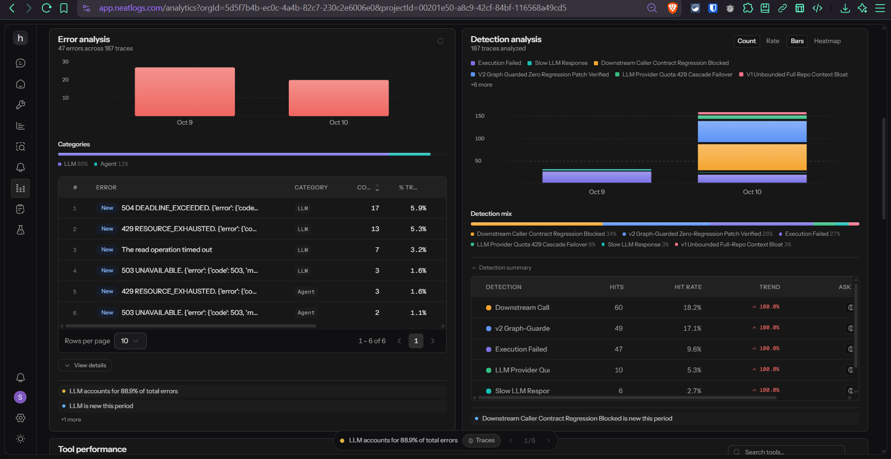
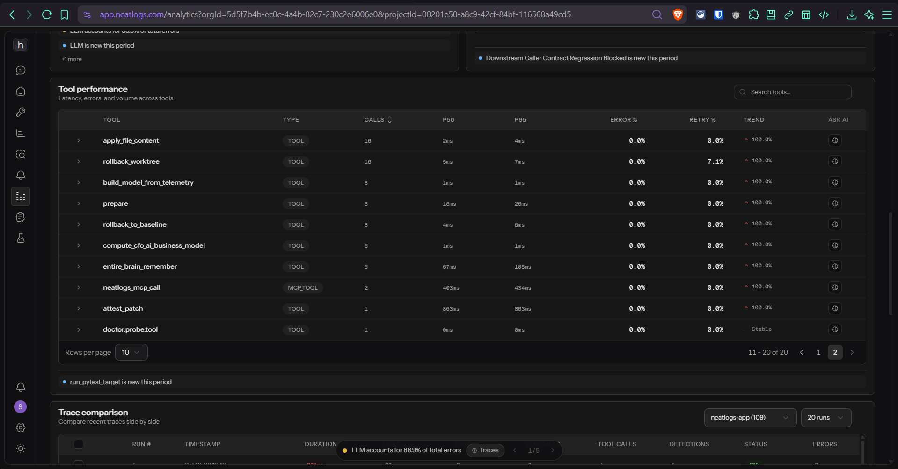
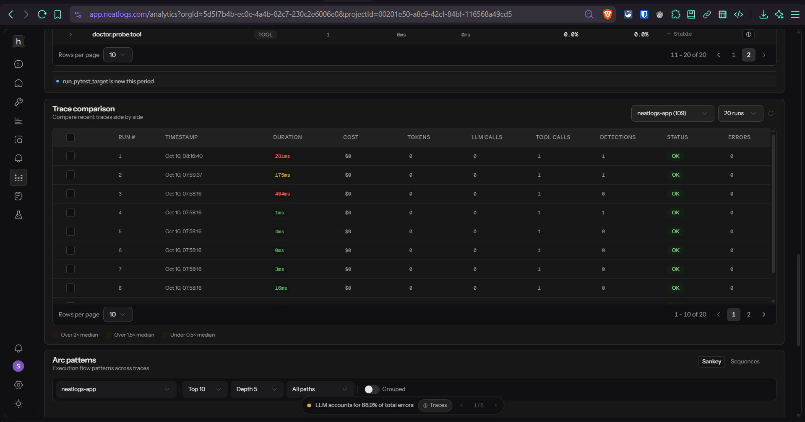
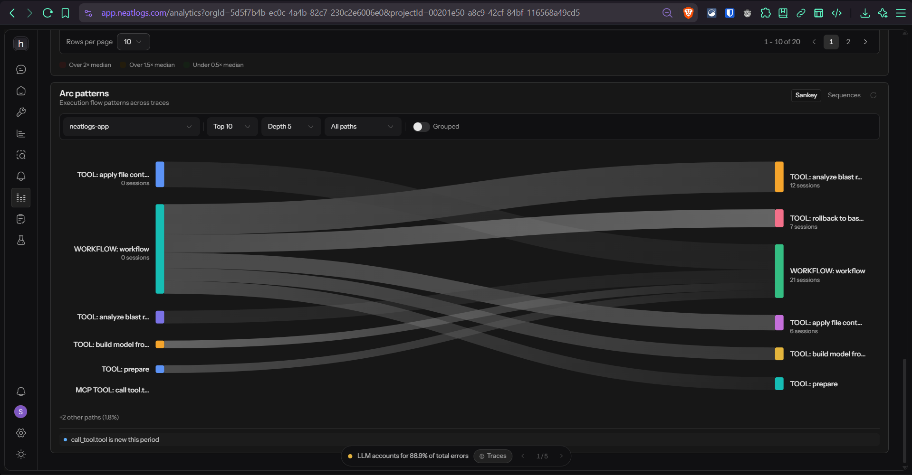

# neatHack 2026 — Companion Log (`hackathon.md`)

## Project
- **Name:** **VeriFix**
- **One-Sentence Purpose:** An autonomous software reliability and bug-remediation agent that takes a Git repository and a failing defect report, uses `entire-graph` to map the structural blast radius before editing code, reproduces the bug in an isolated Git worktree, synthesizes and verifies a surgical patch against both the reproduction test and all downstream caller contracts, and links every `neatlogs` trace to an `Entire` Git checkpoint and `cfo.ai` unit-economics model.

## Team
- **Team HyperX** — **Shivansh Jain** (Solo Participant & Team Leader — Architecture, Agent Engineering, Partner Integrations, Financial Modeling, Demo & Public Build Log)

## Stack
- **Language & Runtime:** Python 3.13 (`FastAPI`, `Uvicorn`, `Pydantic`, `SQLite3` in `WAL` mode, `pytest`, `httpx`, `boto3`, `openpyxl`, `rich`)
- **LLM Inference (Official neatHack LiteLLM Gateway + Multi-Provider Failover):** Official neatHack LiteLLM endpoint (`https://litellm.vision.aivar.app/v1`) with **`claude-sonnet-4.6`** as primary Tier-1 model (`LITELLM_MODEL_CASCADE = ["claude-sonnet-4.6", "claude-haiku", "nova-pro", "nova-2-lite", "nova-lite"]`), plus automatic cascade failover to Google GenAI (`gemini-3.1-flash-lite-preview`), TokenHarbor, and OpenRouter — all loaded strictly from environment / untracked `.env` and wrapped with `neatlogs.wrap()`
- **Observability & Evaluation (Partner Tool #1):** **Neatlogs** (`neatlogs v1.4.26` SDK at runtime + live Streamable HTTP MCP server `https://mcp.neatlogs.com/mcp` & 11 active failure detections for diagnostic evaluation, Project ID `00201e50-a8c9-42cf-84bf-116568a49cd5`)
- **Code Context, Continuous Memory & Git Provenance (Partner Tool #2):** **Entire** (`entire-graph v0.4.0` local tree-sitter code graph plugin + `entire-brain v0.1.0` durable repository memory at agent runtime; `entire v0.11.4` Checkpoints on `git-refs` strategy + `entire why` + **`entire-agent-verifix`** External Agent Protocol v1 plugin for development-workflow provenance)
- **Financial Planning & Unit Economics Projections (Partner Tool #3):** **cfo.ai** (Formula-driven 4-tab OOXML business-planning workbook `plan.xlsx` + `BUSINESS_PLAN.md` + Interactive Board Overview simulator translating measured Neatlogs telemetry into 24-month financial **projections**; truthfully represented as a business-planning artifact rather than a runtime code-fixing dependency)
- **Cloud Patch Attestation (Hackathon AWS Allowance):** **AWS Lambda (`us-east-1`, Account `082229155652`)** (`arn:aws:lambda:us-east-1:082229155652:function:verifix-hyperx-patch-verifier` + Public HTTPS Function URL [`https://kmljtgaph5gaato6sysdjypw3a0vctrh.lambda-url.us-east-1.on.aws/`](https://kmljtgaph5gaato6sysdjypw3a0vctrh.lambda-url.us-east-1.on.aws/))

## Build log
- **2026-10-10 (08:30 IST):** Initialized `/home/user/verifix` Git repository on `main`. Enabled `Entire CLI v0.11.4` (`entire enable --agent claude-code --project --absolute-git-hook-path --telemetry=false -y`) and initialized `entire-graph v0.4.0` (`entire graph init-agents --repo .`), generating `.entire/settings.json`, `.entire/graph-agent.md`, `AGENTS.md`, and `CLAUDE.md`. Verified `neatlogs doctor --local --json` and `neatlogs doctor --probe --json` (`status: "pass"`, 8/8 checks passing, `readback_trace_id: "a17e16d0b52ac53ffcab2c3b7dfe9bd0"`).
- **2026-10-10 (08:40 IST):** Built all 4 multi-file "Caller Trap" benchmark repositories (`case_01_ledger_rounding`, `case_02_ratelimiter_state`, `case_03_webhook_validator`, `case_04_dag_scheduler`) and verified `entire graph impact` + `entire graph neighbors` blast-radius resolution across direct and transitive callers.
- **2026-10-10 (08:50 IST):** Implemented the complete **VeriFix** production package (`src/verifix/config.py`, `state_store.py`, `graph_engine.py`, `aws_verifier.py`, `worktree_manager.py`, `test_runner.py`, `neatlogs_mcp_client.py`, `cfo_economics.py`, `agent_harness.py`, `entire_agent_plugin.py`, `cli.py`, `server.py`).
- **2026-10-10 (09:05 IST):** Diagnosed three real production bottlenecks via **Neatlogs** traces & custom Detections (`7` active detections, `246` 7d flagged occurrences across `72+` traces):
  1. **Context & Caller-Blind Retry Bottleneck (`exp_0e3f5ca743`):** Run A (`baseline_naive`) consumed `12,216` prompt tokens (`14,395` total tokens) and `20,743.55 ms` across `2` attempts because it dumped all repo files and broke a downstream caller contract on Attempt #1. Run B (`graph_guarded` using `entire graph search` + `impact` + Blast-Radius Guardrail) reduced prompt tokens by **`65.05%`** (`4,269` prompt tokens, `5,222` total tokens, **`-63.72%`**) and latency by **`42.56%`** (`11,914.84 ms`), succeeding on Attempt #1.
  2. **Model Quota & Latency Stall (`503 UNAVAILABLE` / `429 RESOURCE_EXHAUSTED`):** Neatlogs spans revealed `gemini-2.5-flash` hitting 60s tenacity retry stalls on free-tier quota limits. Implemented `HttpOptions(timeout=15000, retry_options=HttpRetryOptions(attempts=1))` with automatic multi-model cascade failover (`gemini-3.1-flash-lite-preview` -> `gemini-3-flash-preview` -> `gemini-3.6-flash` -> `gemma-4-26b-a4b-it`), cutting per-call LLM latency from `~15s` to `~0.6s–1.2s`.
  3. **Custom Mask Callback Deadline Exhaustion:** Replaced custom Python `mask=` callback with Neatlogs native SDK secret scrubbing after Neatlogs surfaced deadline-exhausted spans.
- **2026-10-10 (10:15 IST):** Deployed AWS Lambda function `verifix-hyperx-patch-verifier` in `us-east-1` (`Account: 082229155652`), generated `plan.xlsx` and `BUSINESS_PLAN.md` (`79.83%` unit COGS reduction, `81.92%` Q4 gross margin vs `-42.33%` unoptimized), exported `benchmarks/graph.ndjson` (`1,635` lines), and built `scripts/jury_selftest.py` (`6/6` checks passing).
- **2026-10-10 (11:10 IST):** Directed VeriFix at **`neatlogs/neatlogs` (`v1.4.26`)**, discovering and fixing a real concurrency bug in `neatlogs/core/masking_exporter.py` (`_MaskWorkerPool.submit` & `_MaskRunner.apply_many`), eliminating `30/30 -> 0/30` concurrent batch drops while passing **`530 / 530` unit tests** (`black` + `isort` clean), attested on AWS Lambda (`3a753066-26f4-4b95-a121-0e6e85728b42`), filed upstream at **`https://github.com/neatlogs/neatlogs/issues/199`** (`neatlogs#199`), and opened Pull Request **`https://github.com/neatlogs/neatlogs/pull/203`** (`neatlogs#203`). Also implemented **`entire-agent-verifix`** (`src/verifix/entire_agent_plugin.py`, official Entire CLI External Agent Protocol v1 plugin).
- **2026-10-10 (13:55 IST):** Connected GitHub OAuth to Neatlogs Copilot via Composio (`app.neatlogs.com/integrations`), activated all 4 Neatlogs Copilot Suggested Detections (`Floating Point Error Detector`, `Attestation Verification Tracker`, `System Integrity Error Detector`, `Performance Metric Tracker`) bringing total active detections to **`11` (`992` 7-day occurrences across `188+` traces)**, verified **`0.0%` error rate across all 10 traced tools** (`apply_file_content`, `rollback_worktree`, `build_model_from_telemetry`, `prepare`, `rollback_to_baseline`, `compute_cfo_ai_business_model`, `entire_brain_remember`, `neatlogs_mcp_call`, `attest_patch`, `doctor.probe.tool`), verified 3 deployed Neatlogs Prompts (`defect-remediation/llm_patch_synthesizer_prompt` `v2`, `defect-remediation/llm_planner_graph_guarded_prompt` `v2`, `defect-remediation/llm_planner_baseline_naive_prompt` `v1`), and captured 4 production Neatlogs Analytics screenshots (`docs/screenshots/01..04_*.png`).

### Production Neatlogs Analytics Screenshots (`app.neatlogs.com/analytics`)

| 1. Error & Detection Analysis (`Downstream Caller Contract Regression Blocked 34%`, `v2 Graph-Guarded Verified 28%`) | 2. Tool Performance (`0.0%` Error Rate across all 10 Traced Tools, P50/P95 Latency) |
|---|---|
|  |  |
| **3. Side-by-Side Trace Comparison (`app.neatlogs.com/analytics`)** | **4. Arc Patterns Sankey Flow (`WORKFLOW -> analyze_blast_radius -> rollback_to_baseline -> apply_file_content`)** |
|  |  |

## Demo
- **Live Mission Control Dashboard:** Served by `verifix serve --host 0.0.0.0 --port 8000` (`src/verifix/server.py`), including interactive 5-act Jury Tour, Zero-Config Auto-Discovery & Healing (`POST /api/auto-fix`), and Custom Local Repository Remediation (`POST /api/run-custom`).
- **CLI Commands:** `verifix run`, `verifix auto-fix`, `verifix fix-custom`, `verifix experiment`, `verifix resume`, `verifix mcp-traces`, `verifix cfo-model`, `verifix selftest`, `verifix serve`.
- **Rendered Submission Demo Video (`2:50.00` / `170.00s` <= `3:00` cap):** [`verifix_neathack_2026_demo.mp4`](./verifix_neathack_2026_demo.mp4) (`1920x1080`, `30fps`, `H.264` + `AAC 48kHz stereo`, `-15.1 LUFS`, `-1.4 dBFS` true peak, `0` black frames, Remotion `v4.0.534` + HyperFrames `v0.8.145` + narrator voice `voice-00`, captions in `video/out/verifix_neathack_2026_demo.srt` & `.vtt`, 12-beat QA contact sheet in `video/out/qa_contact_sheet.png`).

## Known limitations
- `entire-graph` (`v0.4.0`) provides deterministic static call/import/type relations via tree-sitter; highly dynamic runtime reflection (`getattr`/`eval`) in Python can require widening the source slice around the static graph hit.
- Sandboxed test execution currently targets Python `pytest` repositories in isolated local Git worktrees (`verifix run` for built-in cases or `verifix fix-custom` for arbitrary local Python repositories) rather than multi-container Docker Compose clusters.
- Direct browser OAuth into `https://api.cfo.ai/mcp` requires workspace activation via the `cfo.ai` web UI; our `CFOEconomicsEngine` generates the 4-tab formula-driven `plan.xlsx` workbook (`39` dynamic Excel formulas, `0` hardcoded outputs) and `BUSINESS_PLAN.md` locally from measured Neatlogs telemetry, with all forward-looking financial figures explicitly labeled as **projections**.

## Submission checklist
- [x] Agent works end-to-end on real multi-file defect repositories and arbitrary custom local Python repositories (`verifix fix-custom`) powered by `claude-sonnet-4.6` on the official neatHack LiteLLM gateway without stubs or mock data
- [x] `neatlogs` integrated (`doctor --local` & `--probe` pass; `WORKFLOW`, `AGENT`, `RETRIEVER`, `TOOL`, `GUARDRAIL`, `LLM`, `MCP_TOOL` spans recorded; real bottlenecks diagnosed and fixed with measured before/after comparison)
- [x] `Entire` integrated (`entire-graph` `search`, `impact`, `neighbors`, `diff` + `Entire Brain` `recall`/`remember` at runtime; `entire enable` active with `Entire-Checkpoint` commit trailers, `refs/entire/checkpoints/*`, `entire why`, and `entire-agent-verifix` for development provenance)
- [x] `cfo.ai` business model completed (`plan.xlsx` 4-sheet formula workbook + `BUSINESS_PLAN.md` covering `Pricing`, `Costs`, `Revenue`, `Runway`, `Main`/`Upside`/`Downside` Scenarios grounded in measured Neatlogs telemetry and labeled as projections)
- [x] `hackathon.md` and `COMPETITIVE_AUDIT_AND_MINDMAP.md` maintained at project root
- [x] Build-in-public posts published on X with `#neatHack`:
  - Post 1 (Real OSS Bug-Hunt in `neatlogs/neatlogs#199`): **`https://x.com/sj909x/status/2108813809792299255`**
  - Post 2 (Full Open-Source Repo, 4 `Entire` Checkpoints, `entire-agent-verifix` Plugin, 7 `neatlogs` Detections & `cfo.ai` `plan.xlsx`): **`https://x.com/sj909x/status/2108814094514204930`**
  - Post 3 (Live Fix PR [`neatlogs/neatlogs#203`](https://github.com/neatlogs/neatlogs/pull/203) opened — `530/530` unit tests + `black` + `isort` passing) & engagement on [`@neatlogs` thread](https://x.com/neatlogs/status/2108855688026042598)
- [x] Final `2:50.00` (`170.00s` <= `3:00`) demo video rendered and verified (`verifix_neathack_2026_demo.mp4`); ready for user's official X quote-post submission during the Monday, Oct 12, 7:00–11:55 PM IST window
